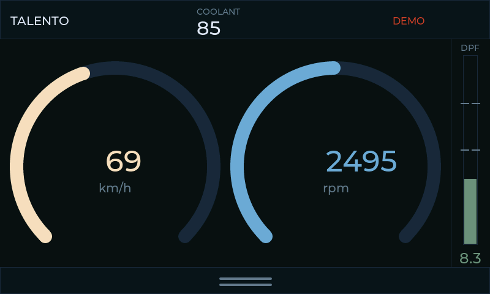
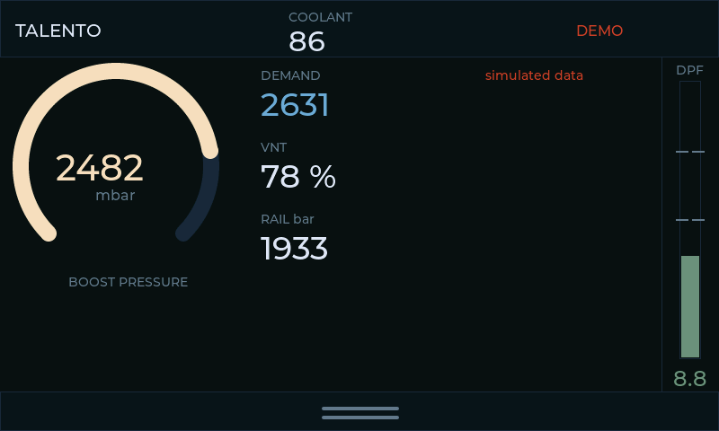
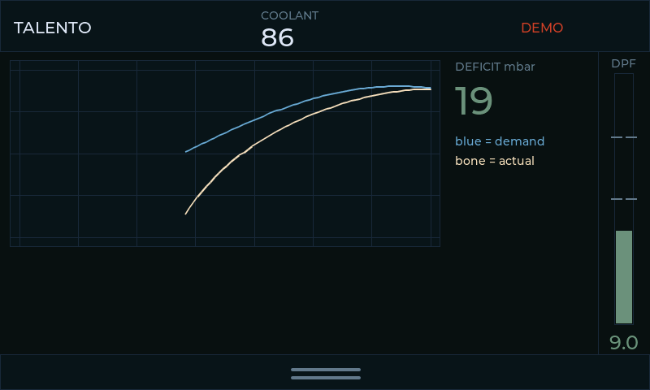
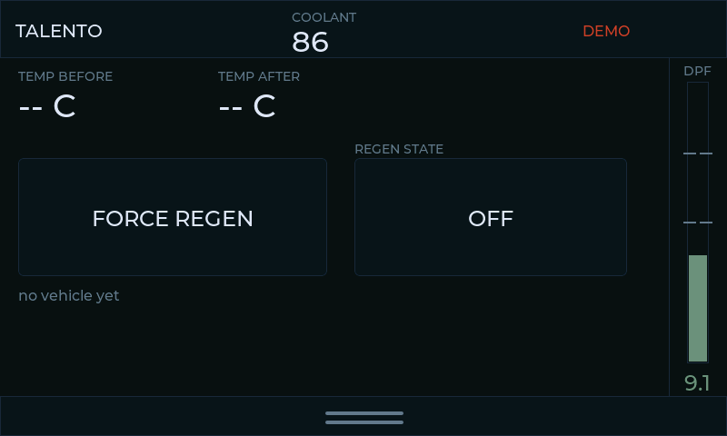

# canograf

Open CAN-bus diagnostic recorder with a touchscreen. Reads live values and
fault memory from vehicle ECUs and draws them like a chart recorder.

Built first for a **Waveshare ESP32-S3-Touch-LCD-4.3B (rev 1.1)** and a
**Fiat Talento 2020 / Renault Trafic III (platform X82)**, but both the
hardware and the vehicle side are meant to be swappable:

- **Other boards** - anything with an ESP32 and a CAN transceiver. The pinout
  lives in one place, see [`docs/hardware/`](docs/hardware/).
- **Other vehicles** - a vehicle profile is just a table of data identifiers
  with scaling. See [`docs/vehicles/`](docs/vehicles/). Pull requests with new
  cars are very welcome.

> Status: **work in progress.** The UI runs on the board, the CAN layer is not
> written yet, values on screen are simulated. See [ROADMAP.md](ROADMAP.md).

---

## Why

A laptop plus an ELM327 dongle works, but it is slow and clumsy in a vehicle.
An ELM327 clone cannot send a CAN message longer than 7 data bytes and tops out
at roughly 3-4 samples per second over its serial link. Talking to the ESP32
TWAI controller directly removes both limits and fits in a device you can leave
on the dashboard.

The part that actually takes time is not the code, it is knowing **which data
identifier means what and how to scale it**. That knowledge is in
[`docs/vehicles/`](docs/vehicles/) and it is verified against a real car, not
copied from a forum.

## Hardware

| | |
|---|---|
| Board | Waveshare ESP32-S3-Touch-LCD-4.3B rev 1.1 (`ESP32-S3-WROOM-1-N16R8`) |
| Display | 4.3" IPS, 800x480, 16 MB flash, 8 MB PSRAM |
| Touch | GT911, capacitive, 5 point |
| CAN | TJA1051T/3 on `GPIO15` (TX) and `GPIO16` (RX) |
| Power | 7-36 V DC or USB-C, about 3 W |

Wiring to an OBD-II (SAE J1962) socket:

```
OBD pin 6   ->  CAN H
OBD pin 14  ->  CAN L
OBD pin 4   ->  GND
OBD pin 16  ->  VIN     (fused, 1 A)
```

Leave the on-board 120 ohm CAN termination switch **off** - the vehicle bus is
already terminated at both ends.

## Build and flash

```sh
python3 -m venv .pio-venv
.pio-venv/bin/pip install platformio
.pio-venv/bin/pio run              # build
.pio-venv/bin/pio run -t upload    # flash over USB-C
```

Versions in `platformio.ini` are pinned on purpose - see
[CLAUDE.md](CLAUDE.md) for why.

### Tests on a host

The transport layer is deliberately split in two: `src/can/twai.c` is the only
file that knows ESP-IDF, while the ISO-TP state machine in `src/can/isotp.c`
has no clock and no driver - frames leave through a callback and the current
time arrives as an argument. So it runs on a laptop, with no board and no
vehicle:

```sh
cmake -S test -B test/build
cmake --build test/build
./test/build/isotp_test            # exit code 0 = everything passed
```

No LVGL, nothing downloaded, a couple of seconds. Covered: single frame both
ways, multi-frame receive, multi-frame send with block size 1, a flow control
that never arrives, the 150 ms N_Cs guard and `0x78` responsePending. CI runs
the same binary on every push.

## Configuration

Write protection, the vehicle profile, the board profile and the optional
modules are switched through layered `.env` files, **not** by editing
`platformio.ini`. Layers, from lowest priority to highest:

```
config/default.env             defaults, and the list of every valid key
config/board/<board>.env       one board
config/vehicle/<vehicle>.env   one vehicle platform
local.env                      yours only, never in the repository
```

Every build prints a table of the resulting configuration and the file each
value came from, so it is always clear what was built.

For settings that apply only to your bench:

```sh
cp local.env.example local.env
```

```sh
# local.env - overrides everything else, gitignored
CANOGRAF_DEFAULT_LANG="cs"
CANOGRAF_ALLOW_WRITE=on        # write code in the image, still behind the gate
```

A key that is not in `config/default.env` stops the build rather than being
ignored. Full list of keys and how to add a board or a vehicle:
[`config/README.md`](config/README.md).

## Writing to the vehicle

Reading is safe and never restricted - live values, fault memory and stored
records can be read as often as you like and nothing in the vehicle changes.

Writing is different. The device can reset service data, reconfigure the energy
module and start a particulate filter regeneration, which heats the exhaust past
600 C. A wrong value can leave a vehicle unable to start. So a write has to get
through three gates, and a mis-tap cannot open any of them:

1. **The build.** The default firmware has no write code in it at all. Not
   hidden, not disabled - not compiled in. This is what you get if you just
   build and flash.
2. **A switch in Settings**, "Enable write functions", off every time the device
   starts. It is never stored: a restart locks it again.
3. **A sequence.** Turning the switch on shows a short page explaining what
   writing can do, then plays a four step pattern on four pictures - house,
   lightning bolt, gear, key - which you repeat back. Three tries, then a
   minute's wait. Pictures and digits rather than colours, so colour vision
   plays no part in it.

Once unlocked it stays unlocked until the device restarts - the sequence is a
captcha, not something you repeat for every write. Each individual write still
asks for a plain confirmation showing what is about to be sent.

**The same gate covers the planned web interface and ELM327 emulation.** A
remote client can never unlock anything; while the device is locked its writes
are refused in the transport layer, wherever they came from. Only a person at
the touchscreen can open the gate.

### Building without the protection

If you work on control units all day, repeating a sequence gets old. The gate
can be compiled out:

```sh
# writing compiled in, still behind the sequence
PLATFORMIO_BUILD_FLAGS=-DCANOGRAF_ALLOW_WRITE=1 .pio-venv/bin/pio run

# writing compiled in, no gate at all
PLATFORMIO_BUILD_FLAGS="-DCANOGRAF_ALLOW_WRITE=1 -DCANOGRAF_WRITE_UNLOCKED=1" \
  .pio-venv/bin/pio run
```

What you take on with the second one: **any touch on a write control acts
immediately**, with no sequence in the way, and so does any request from the web
interface or from a tool connected to the ELM327 emulation - including from a
script that is not watching what the vehicle is doing. Such a build shows a
permanent `WRITE UNLOCKED` badge so it cannot be mistaken for a normal one after
it has been left in a vehicle. Do not hand it to anyone else and do not leave it
installed.

There is a third way, for when rebuilding is not practical: a **Skip the write
confirmation** switch in the debug panel. It skips the sequence for the current
run only and is forgotten at the next restart. Compiling is still the better
answer - a switch only skips the question, while a build without write support
does not contain the code at all.

The debug panel also has **Try captcha**, which runs the sequence as a
rehearsal: it unlocks nothing and sends nothing, so the mechanism can be tried
without a vehicle connected.

The reasoning, and the full list of which requests are gated and which are not,
is in [`docs/safety.md`](docs/safety.md).

## Languages

The interface speaks **English** (default), **Czech** and **German**. The
button on the settings page cycles between them and the choice survives a
reboot.

Every string lives in one file per language in [`lang/`](lang/). Adding a
language is one new file and one line in a table - no other code changes - and
a translation-only pull request is welcome. The fonts already carry Czech and
German diacritics; other scripts need the fonts regenerated, which is one
command. See [`lang/README.md`](lang/README.md).

## Screens

| | |
|---|---|
|  |  |
|  |  |

These are not mock-ups. They are rendered from the real UI code by a host
build, so they cannot drift from what the device shows. CI regenerates them on
every push to `main` and commits the result, which also means a pull request
that changes the interface shows the difference as an image diff.

Values are simulated until the CAN layer lands. See [`sim/`](sim/) to run it
yourself - no board needed.

## Documentation

| | |
|---|---|
| [CLAUDE.md](CLAUDE.md) | How the project is put together, conventions, traps |
| [ROADMAP.md](ROADMAP.md) | What is planned and what is deliberately not |
| [`docs/vehicles/`](docs/vehicles/) | Per-vehicle data identifier maps |
| [`docs/hardware/`](docs/hardware/) | Per-board pinouts and measurements |
| [`docs/ui.md`](docs/ui.md) | Why the interface looks the way it does |
| [`docs/safety.md`](docs/safety.md) | The gate between reading and writing, and why it is built that way |
| [`lang/README.md`](lang/README.md) | How to add a language |
| [`config/README.md`](config/README.md) | Build configuration layers, every key, adding a board or a vehicle |

## Licence

**GPLv3.** See [LICENSE](LICENSE).

Chosen deliberately: anyone may use, study and modify this, but a derivative
has to stay open too. The vehicle knowledge in `docs/` was expensive to gather
and should not end up locked inside somebody's closed product.

**No warranty.** Writing to a control unit can disable your vehicle. Reading is
safe, writing is not.

Write access is **not in the default build at all** - it has to be compiled in
deliberately, and even then it stays locked until somebody unlocks it on the
device itself. See [`docs/safety.md`](docs/safety.md).
