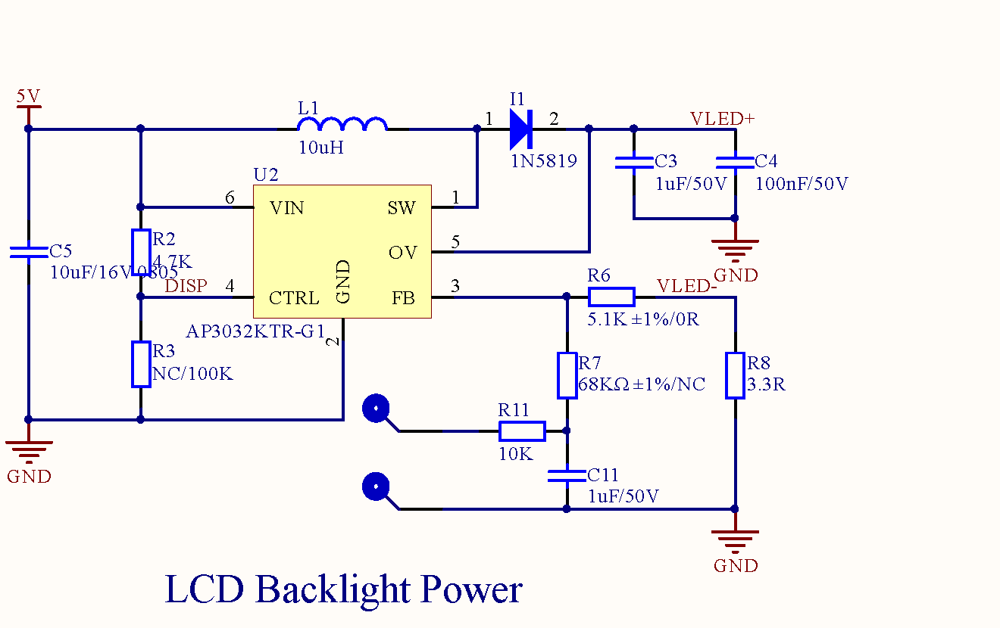
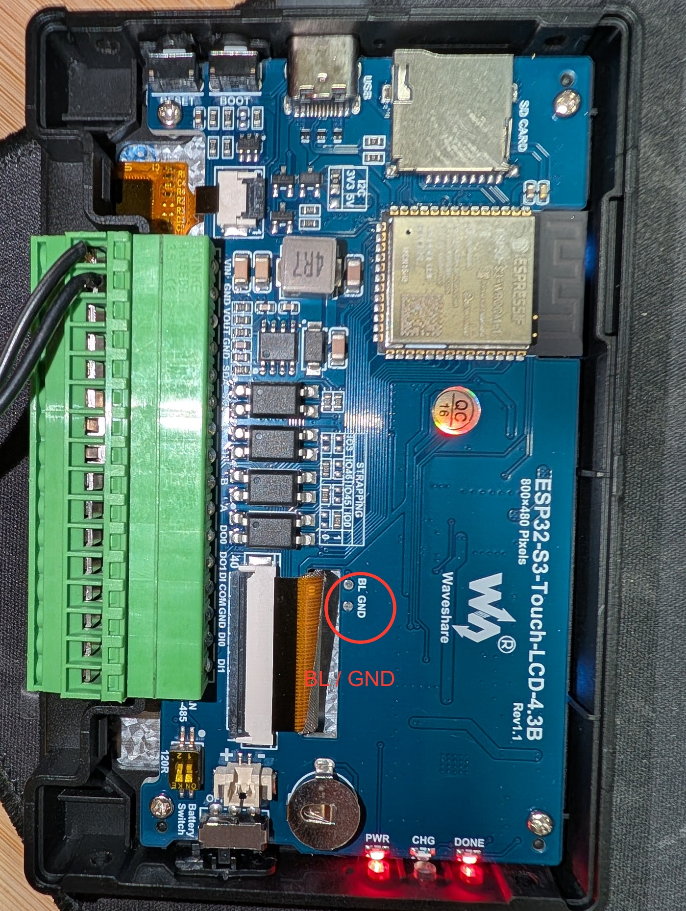
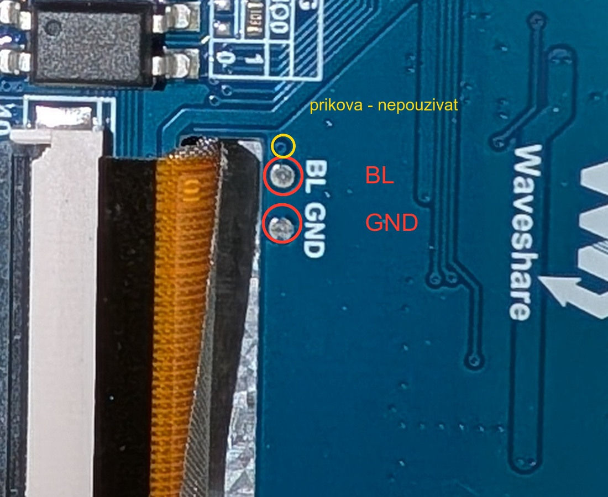

# Backlight of the Waveshare ESP32-S3-Touch-LCD-4.3B

Rev 1.1. Everything below is either **[SCH]** read off the official schematic,
**[DS]** quoted from the AP3032 datasheet, **[MEAS]** measured on this board,
or **[INFER]** reasoning marked as such.

---

## Short version

The board **can** be dimmed, and Waveshare left the hook for it on the
silkscreen. The two pads marked `BL` / `GND` next to the LCD connector are not
a test point for the backlight state - they are the **analog dimming input of
the backlight boost converter**, wired exactly the way the AP3032 datasheet
draws it in its "dimming with a filtered PWM voltage" figure.

Driving `BL` from 0 V up to about 3 V sweeps the LED current from full down to
zero. No cutting, no desoldering, two wires.

And the reason software PWM on `EXIO2` looks like a slow driver is almost
certainly not the driver: `EXIO2` also drives the panel's own `DISP` pin, so
every PWM cycle switches the LCD itself off and on.

---

## The circuit



**[SCH]** Block "LCD Backlight Power", schematic page 1. Every part of this
block is on the **bottom** side of the PCB (schematic page 3), roughly under
the LCD FPC connector.

| Ref | Value | Role |
|---|---|---|
| `U2` | **AP3032KTR-G1**, SOT-23-6, marking `GJL` | white-LED step-up converter |
| `L1` | 10 uH | boost inductor, `5V` to `SW` |
| `I1` | 1N5819 | boost rectifier, `SW` to `VLED+` |
| `C3` / `C4` | 1 uF/50 V + 100 nF/50 V | output caps on `VLED+` |
| `C5` | 10 uF/16 V | input cap on the 5 V rail |
| `R2` | 4.7 k 0805 | `CTRL` pull-up to 5 V |
| `R3` | `NC/100K` - **not fitted** | optional `CTRL` pull-down |
| `R6` | **5.1 k +-1%** (alt. `0R`) | `FB` to `VLED-` |
| `R7` | **68 k +-1%** (alt. `NC`) | `FB` to the dimming node |
| `R8` | **3.3 R** | current sense, `VLED-` to `GND` |
| `R11` | 10 k | `BL` pad to the dimming node |
| `C11` | 1 uF/50 V | dimming node to `GND` |
| `P16` / `P17` | round pads | the `BL` and `GND` pads on the silkscreen |

**[DS]** AP3032 pinout, confirmed identical to the schematic:
`1 SW`, `2 GND`, `3 FB`, `4 CTRL`, `5 OV`, `6 VIN`.

Topology:

```
DC_5V ---+--- L1 10uH ---+--- I1 1N5819 ---+--- VLED+ ---> panel LED string
         |               |                 |
         +--- VIN   U2   SW                +--- C3 || C4 --- GND
         |     AP3032                      |
         |              OV ----------------+          (OV tied straight to
         |                                              the output, per [DS])
         |
   DISP -+--- CTRL      FB ---+--- R6 5.1k --- VLED- --- R8 3.3R --- GND
         |                    |
      R2 4.7k to 5V        R7 68k
      R3 (DNP) to GND         |
                              X ---+--- R11 10k --- [BL pad]
                                   |
                                   +--- C11 1uF --- GND --- [GND pad]
```

The LED string itself is inside the panel; only `VLED+` (FPC pin 2) and
`VLED-` (FPC pin 1) come out. **[SCH]**

Supply: the 5 V rail is the output of the `SY8293FCC` buck (`U1`), feedback
divider `R10` 100 k / `R17` 13 k against a 0.6 V reference, i.e. nominally
**5.21 V**, not 5.00 V. **[SCH + calculation]**

### Who drives CTRL

**[SCH]** `CH422G` pin 15 (`IO2`) -> `R21` 100 R -> net `EXIO2` = net `DISP`,
and that one net goes to **both**:

- `U2` pin 4 `CTRL` (backlight driver enable), and
- `PORT1` pin 31 `DISP` (the panel's own display-enable pin).

> Reading the schematic PDF: Waveshare connects nets through the big
> `WROOM-1/2 | LCD | USB | SD | RS485 | CAN | RTC | DI/DO` table at the bottom
> of page 1. Each row of that table is a wire carrying several net labels, so
> the table *is* the netlist. `EXIO2` and `DISP` look like separate nets until
> you notice they share a row. The same trick ties `IO6` to `RTC_INT`, `OD0` to
> `DO0`, and so on.

---

## What the BL / GND pads are, and why they read 0.19 V / 0 V / 82 kohm





The pads sit on the **top** side, between the `STRAPPING` silk table and the
LCD FPC connector. Silkscreen: `BL GND`. **[SCH + photo, rev 1.1]**

They are the two bare tinned circles *next to* the `BL` and `GND` legend, not
the small via above them. `BL` is the one closer to the strapping table.

`BL` (`P16`) goes through `R11` 10 k to a node (call it **X**) that has
`C11` 1 uF to ground and `R7` 68 k up to the `FB` pin. `GND` (`P17`) is plain
board ground.

**[DS]** The AP3032 datasheet, Application Information section 5.2, offers
exactly this: *"using a filtered PWM signal ... The filtered PWM signal can be
considered as a varying and adjustable DC voltage"*, Figure 20, *"Dimming
Control Using Filtered PWM Voltage"*. `R11` + `C11` are the filter, `R7` is the
summing resistor into `FB`. **The pads are a dimming input, nothing else.**

Now the three measurements.

### 0.19 V with the backlight on

**[DS]** The AP3032 regulates `FB` at **200 mV typ, 188 / 212 mV min / max**
("Feedback Voltage V_FB", Electrical Characteristics).

With nothing connected to the pad, no DC current can flow in `R7`: the far end
of `R11` is open and `C11` blocks DC. A node with zero current through `R7`
sits at exactly the `FB` voltage. A 10 Mohm meter across the pads adds about
19 nA, which drops ~1 mV across `R7`.

So the pad voltage **is** the chip's internal feedback reference:

```
V(BL) = V_FB = 0.19 V measured, against 0.188-0.212 V guaranteed
```

Exact match, and it also says the reference on this particular part sits at the
low end of its window. **[MEAS + DS]**

### 0.00 V with the backlight off

`EXIO2` low -> `CTRL` low -> converter disabled -> no LED current, `VLED-` at
0 V, `FB` at 0 V, and node X discharges through `R7`+`R6`+`R8` to ground. The
pad follows to 0 V. **[MEAS + SCH]**

### 82 kohm with no power

Path from the `BL` pad to `GND` with the chip dead and all pins high-Z:

```
R11 10 k  +  R7 68 k  +  R6 5.1 k  +  R8 3.3 R  =  83.10 kohm
```

Measured **82 kohm**, i.e. 1.3 % low. `R6` and `R7` are +-1 %, `R11`'s
tolerance is not printed, and the meter has its own error. **This is a match.**

It is also the decisive evidence about which build option is stuffed. The
schematic offers two:

| Option | `R6` | `R7` | Pad to GND would read | Dimming authority |
|---|---|---|---|---|
| **A (fitted)** | 5.1 k | 68 k | **83.1 k** | full |
| B | 0 R | NC | open circuit | none |

82 kohm rules out option B outright, and it rules out the nonsensical mixed
build (`0R` + `68k`, which would read 78.0 k and would give almost no dimming
range anyway, because without `R6` the injected current just adds to the 3.3 R
sense resistor instead of offsetting the reference).

**Conclusion: all three numbers are explained, consistently, by one fact - the
BL pad is the high-impedance FB summing node of a populated dimming network.**
Nothing is left unaccounted for.

### Why 40 microamps through a 10 k resistor can control 60 milliamps of LED

The obvious objection is that injecting a few tens of microamps into a node
that ends in a 3.3 R sense resistor should do nothing at all. It would, if
`FB` sat directly on `R8`. It does not - `R6` 5.1 k is in between, and that is
the whole point of the network.

`FB` is a **regulated** node: the loop holds it at 200 mV and the pin itself
draws nothing. So Kirchhoff at `FB` says the current arriving through `R7`
must be cancelled exactly by the current through `R6`:

```
(V_VLED- - V_FB)/R6  =  -(V_X - V_FB)/R7
V_VLED-              =  V_FB - (R6/R7) * (V_X - V_FB)      R6/R7 = 0.075
I_LED                =  V_VLED- / R8
```

The current gain from node X to the LED string is `R6/R8` = 5100/3.3 =
**1545x**. 40 uA injected becomes 62 mA of LED current. The injected current
never has to be comparable to the LED current - only to the current in `R6`,
which is three orders of magnitude smaller.

With `R6` = 0 R (build option B) that gain collapses to nothing, which is
exactly why option B has no dimming authority.

### How much current actually goes into the LEDs

This is the one thing the schematic alone cannot pin down.

**[DS]** The datasheet formula is `R_ISET = 200 mV / I_LED`. With `R8` = 3.3 R
that is the designer's intent: **61 mA** (57.6 mA if you use the measured
0.19 V reference instead of the 200 mV typ).

**[DS]** But `FB` also has a "Feedback Bias Current" of **35 uA typ, 100 uA
max**, and with `R6` = 5.1 k in the path that bias develops up to
35 uA x 5.1 k = **179 mV** of offset across `R6` - comparable to the whole
200 mV reference. **[INFER]** Since the panel is clearly bright, the bias must
flow *into* the `FB` pin, which pushes `VLED-` **up**, so the real current is
somewhere between 58 mA and roughly 110 mA. The datasheet never contemplates
driving `FB` through kilo-ohms, so this is a genuine open question, not a
rounding error.

**It does not affect the dimming math below** - the slope `dV(VLED-)/dV(X)`
is `-R6/R7` regardless of bias - but it does decide whether 3.3 V on the pad
can reach *full* off or only part way.

**Resolve it with one measurement:** with the backlight on, measure DC volts
from `VLED-` to `GND` (the top pad of `R8`, bottom side, or FPC pin 1).
`I_LED = V / 3.3`. While you are there, `VLED+` to `GND` gives the string
voltage and therefore the LED topology.

---

## Why software PWM on EXIO2 does not work

Our own numbers: 100 Hz black, 50 Hz black, 25 Hz at 70 % duty (28 ms on) just
barely flickers into life. The previous note in this repo blamed a slow boost
driver. **That explanation is wrong.**

**[DS]** The AP3032 is fast:

| Parameter | Value |
|---|---|
| Soft-start time `t_SS` | **300 us** typ, internal, fixed |
| Standby time `t_STANDBY` | **0.7 ms** typ |
| Switching frequency | 1 MHz typ (0.75-1.3 MHz) |
| Recommended dimming PWM on `CTRL` | **>= 25 kHz** |

If `CTRL` goes low for less than ~0.7 ms the part stays in standby and skips
soft-start entirely; if longer, the next enable costs 300 us of soft-start.
Either way: **microseconds, not tens of milliseconds.** The 1.1 uF of output
capacitance is far too small to explain it either.

**[INFER, strong]** What actually takes tens of milliseconds is the **panel**.
`DISP` is shared, so toggling `EXIO2` blanks the LCD itself, and after `DISP`
returns high the RGB panel has to resynchronise to `VSYNC` before it shows
anything. One frame at 60 Hz is 16.7 ms. That lines up with the measurements
better than anything else:

| Our test | On-time | Frames | Result |
|---|---|---|---|
| 100 Hz, any duty | <= 10 ms | < 1 | black |
| 50 Hz, any duty | <= 20 ms | ~1.2 | black |
| 25 Hz at 70 % | 28 ms | ~1.7 | barely visible |

Independent corroboration, though on the non-B *ESP32-S3-Touch-LCD-4.3* (same
`EXIO2`/`DISP` arrangement, different driver chip - MP3302 there):
openHASP discussion
[#602](https://github.com/HASwitchPlate/openHASP/discussions/602), user
`adampr1`: *"EXIO2 control not only LED driver but also DISP signal on LCD
Display, then simple PWM on EXIO2 will lower voltage also on DISP and as effect
will switch off display logic - display to standby."* Their fix is to remove a
resistor to split the driver from `DISP` and run PWM from `GPIO6`; openHASP
ships that at 1000 Hz "to prevent inductor noise".

---

## Every way to change the brightness

Ordered least invasive first. "Reversible" means the board can be put back to
stock without buying parts.

### 1. Drive the `BL` pad - **recommended**

**What:** solder one wire from `GPIO6` to the `BL` pad and one from board
ground to the `GND` pad. Output LEDC PWM at 1-10 kHz; `R11`+`C11` already
filter it into the DC level the FB node wants. `EXIO2` stays the on/off master.

**Transfer function** (exact; `V_X` is the filtered voltage at the internal
node, `V_d` the average voltage applied to the pad):

```
V_X        = 0.872 * V_d + 0.128 * V_FB
dI_LED     = -(R6 / (R7 * R8)) * (V_X - V_FB)   =  -22.7 mA per volt at X
dI_LED/dV_d                                     =  -19.8 mA per volt at the pad
```

From a 3.3 V GPIO:

| Duty | Change in LED current |
|---|---|
| 0 % | +3.8 mA (a hair brighter than stock) |
| 25 % | -12.6 mA |
| 50 % | -28.9 mA |
| 75 % | -45.3 mA |
| 100 % | -61.6 mA |

**Invasiveness:** very low. Two solder joints on pads that exist for this
purpose. Nothing removed, no trace cut.
**Reversible:** yes, completely - unsolder the wires.
**Risks:**
- `GPIO6` is **not free**: it is wired to the `PCF85063` `INT` pin (see the
  board doc). `INT` is open-drain, so driving `GPIO6` push-pull is safe as long
  as the RTC alarm/interrupt outputs stay disabled. You lose the RTC interrupt
  line, not the RTC.
- At low LED current the boost may drop into pulse-skipping; that can whine or
  flicker. **[INFER]** Mitigate by clamping the useful range (e.g. 15-100 %)
  after testing.
- Whether 100 % duty reaches full darkness depends on the unresolved `I_LED`
  question above. Worst case you get deep dimming but not off - and `EXIO2`
  still gives a real off.
- Brightness steps settle in ~40 ms (`R11 || R7` x `C11` = 8.7 ms). Fine for a
  UI slider, not for strobing.

**Does the slow turn-on break it?** No, and it does not apply: this method
never interrupts `CTRL`, so there is no soft-start, no `DISP` toggling and no
panel resync. The LEDs are dimmed by analog current, which is what the
datasheet recommends for stable output.

**Prove it in 10 seconds, with no soldering:** jumper the `BL` pad to a 3.3 V
source (the I2C terminal `VOUT` is 3.3 V by default). Current into the pad is
under 0.5 mA and `FB` abs max is 20 V, so there is no risk. If the screen goes
dark or very dim, the whole analysis above is confirmed. Remove the jumper and
it returns to normal.

### 2. Fixed resistor from the `BL` pad to 3V3

**What:** no MCU involvement - solder one resistor from `BL` to a 3.3 V point.
Permanently lower, fixed brightness.

| Added series resistor | Change in LED current |
|---|---|
| 0 (direct to 3V3) | -61.6 mA |
| 22 k | -48.1 mA |
| 47 k | -38.5 mA |
| 100 k | -27.0 mA |
| 220 k | -16.1 mA |

**Invasiveness:** very low. **Reversible:** yes. **Risk:** none beyond picking
the wrong value. **Recommended?** Only as a stopgap, or if software control is
never wanted. No regulation, but `EXIO2` on/off still works.

### 3. I2C DAC or digital pot driving the `BL` pad

**What:** an MCP4725 (or similar) on the existing I2C bus, output to the `BL`
pad. Same transfer function as option 1, but frees `GPIO6` and keeps the RTC
interrupt.

**Invasiveness:** low on the board (same two pads), but adds a part and wiring.
**Reversible:** yes. **Risk:** one more device on a bus that already carries
GT911, CH422G and PCF85063 - check the address against the occupied ranges
(0x20-0x27, 0x30-0x3F, 0x51, 0x5D).
**Recommended?** Only if `GPIO6` must stay free for the RTC alarm.

### 4. Change the sense resistor `R8`

**What:** replace `R8` (3.3 R, bottom side) with a larger value. Permanently
dimmer, no control at all.

| `R8` | `I_LED` (ignoring FB bias) |
|---|---|
| 3.3 R (stock) | 58 mA |
| 4.7 R | 40 mA |
| 6.8 R | 28 mA |
| 10 R | 19 mA |

**Invasiveness:** medium - hot-air or fine-tip rework on a small chip resistor
on the bottom side, board out of the case.
**Reversible:** only if the original part is kept.
**Risk:** lifting a pad; it also rescales the dimming range of options 1-3.
**Recommended?** No. Option 2 achieves the same thing without touching a
soldered component.

### 5. PWM the `CTRL` pin from `GPIO6`

**What:** the textbook approach, and what the datasheet actually asks for
(>= 25 kHz). **But** `CTRL` and the panel's `DISP` are the same net with no
component between them, so the PCB trace between `U2` pin 4 and `PORT1` pin 31
must be physically **cut**, then `CTRL` fed from `GPIO6` while `DISP` stays on
`EXIO2`. Removing `R21` (100 R, at the CH422G) only disconnects the expander;
it does not separate driver from panel.

**Invasiveness:** high - permanent trace cut on a 4-layer board, plus a bodge
wire.
**Reversible:** only with a repair wire.
**Risk:** cutting the wrong trace; the cut is on the bottom side among fine
pitch routing; and the ability to blank panel and backlight with one signal is
gone.
**Will it work?** Yes - technically the cleanest electrical result (true PWM
dimming, flat LED colour point). **Recommended?** No - option 1 gets a
brightness slider with zero cuts.

### 6. Switch the LED current path with a transistor

**What:** put a MOSFET in series with `VLED-` (or in the `R8` return) and PWM
it from `GPIO6`.

**Invasiveness:** high - the `VLED-`/`R8` path has to be broken and a part
inserted, i.e. lift a resistor, add a transistor plus gate drive.
**Reversible:** poorly.
**Risk:** this fights the converter. Interrupting the LED current makes `FB`
collapse, the loop winds the output up, and the `OV` protection trips at 27 V
typ with low-frequency hiccup switching **[DS]** - audible, stressful for the
parts, and the LEDs see a current spike on every turn-on.
**Recommended?** **No.** Actively worse than doing nothing.

### 7. Replace the driver entirely

**What:** remove `U2` and fit a different driver, or feed `VLED+`/`VLED-` from
an external constant-current source.

**Invasiveness:** maximum. **Reversible:** no. **Risk:** everything.
**Recommended?** No. There is nothing wrong with the AP3032 here; it already
has the dimming input we need, brought out to a labelled pad.

---

## Recommendation

**Take option 1: PWM `GPIO6` into the `BL` pad.**

It is the only option that is simultaneously reversible, requires no component
removal or trace cutting, and uses the mechanism the chip vendor documents and
the board vendor deliberately exposed. The failure mode of the obvious
approaches - the panel blanking because `DISP` is shared - is sidestepped
entirely, because `CTRL` is never touched: `EXIO2` keeps doing on/off exactly
as the stock firmware does, and brightness becomes an independent analog knob.

Price: `GPIO6` stops being available for the PCF85063 alarm interrupt. Since
the RTC alarm flag can be polled over I2C, that is a cheap trade.

Order of work:

1. **Jumper `BL` to 3.3 V** with the board running. Screen dims or goes dark
   -> theory confirmed, nothing soldered yet.
2. **Measure `VLED-` to `GND`** for the real LED current, and `VLED+` to `GND`
   for the string voltage. This says how much dimming range a 3.3 V drive
   actually buys. Needs access to the bottom side.
3. Solder `GPIO6` -> `BL` and `GND` -> `GND`, LEDC at ~2 kHz, 10-12 bit.
4. Characterise: sweep duty, note where it stops being usable (pulse skipping,
   whine, colour shift), clamp the UI range to the good part.
5. Keep `EXIO2` as the hard on/off, and drive the `BL` duty to 0 when switching
   the backlight back on so it comes up at full brightness.

---

## Sources

- Schematic: <https://files.waveshare.com/wiki/ESP32-S3-Touch-LCD-4.3B/ESP32-S3-Touch-LCD-4.3B-Sch.pdf>
  (page 1 = schematic, page 2 = top assembly, page 3 = bottom assembly)
- AP3032 datasheet, Diodes Inc. / BCD Semiconductor, Dec 2012 Rev 1.2:
  <https://www.diodes.com/assets/Datasheets/AP3032.pdf>
- Waveshare wiki: <https://docs.waveshare.com/ESP32-S3-Touch-LCD-4.3B> -
  documents the backlight **only** as "EXIO2 -> DISP, backlight enable pin".
  No mention of the AP3032, of the `BL` pad, of dimming, or of any backlight
  current. Nothing in this file comes from the wiki.
- openHASP discussion #602 (the non-B 4.3 board):
  <https://github.com/HASwitchPlate/openHASP/discussions/602>
