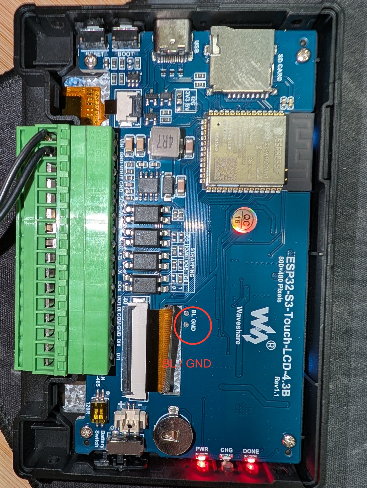

# Waveshare ESP32-S3-Touch-LCD-4.3B

Revision **1.1** (printed inside the enclosure, and on the top silkscreen next
to the Waveshare logo). SKU 27848, or 28141 with case.

Everything with a number in it was measured on this board or read off the
official schematic unless marked otherwise. Where the schematic and the wiki
disagree, the schematic wins and the disagreement is called out.

For the backlight and how to dim it, see **[backlight.md](backlight.md)**.

---

## What is on it

| | |
|---|---|
| Module | `ESP32-S3-WROOM-1-N16R8`, dual Xtensa LX7 at 240 MHz |
| Memory | 16 MB flash, 8 MB PSRAM (octal) |
| Display | 4.3" IPS, 800x480, RGB interface, ST7262, 550 cd/m2 |
| Touch | GT911, capacitive, 5 point, tempered glass |
| Backlight | AP3032 boost driver, **dimmable - see backlight.md** |
| CAN | TJA1051T/3 |
| RS485 | SP3485EN, **automatic direction, no DE pin** |
| Expander | CH422G on I2C |
| RTC | PCF85063ATL with CR927 backup |
| Storage | microSD, **1-bit only** |
| Power | USB-C 5 V or 7-36 V DC (SY8293FCC buck) |
| Battery | MX1.25 connector and CS8501 charger/boost, **cell not included** |
| Audio | **none** - no codec, no amplifier, no I2S |
| Temperature | 0 to 65 C |

## Pin map

| Function | Pins |
|---|---|
| RGB panel | `0 1 2 3 5 7 10 14 17 18 21 38 39 40 41 42 45 46 47 48` |
| Touch | `4` IRQ, `8` SDA, `9` SCL |
| **RTC alarm** | **`6` (`RTC_INT`, PCF85063 pin 4)** |
| USB | `19` D-, `20` D+ |
| microSD | `11` MOSI/CMD, `12` SCK/CLK, `13` MISO/D0 |
| RS485 | `43` RX, `44` TX |
| CAN | `15` TX, `16` RX |
| Buttons | `0` BOOT (`K2`), `EN` RESET (`K1`) |
| Flash + octal PSRAM | `26` to `37` |

Through the CH422G expander:

| | |
|---|---|
| `EXIO0` | isolated digital input `DI0` |
| `EXIO1` | touch reset `CTP_RST` |
| `EXIO2` | `DISP` - **backlight enable *and* panel display-enable, one net** |
| `EXIO3` | `LCD_RST` - routed to LCD FPC pin 35, **which the panel marks NC** |
| `EXIO4` | SD chip select |
| `EXIO5` | isolated digital input `DI1` |
| `OC0` / `OC1` | isolated digital outputs `DO0` / `DO1` |
| `EXIO6` `EXIO7` `OC2` `OC3` | not routed anywhere |

Every expander line goes through a 100 R series resistor.

There is **no** `USB_SEL` on this board. The wiki mentions one; it was copied
from a sibling product. The Type-C data pins go straight to `GPIO19`/`GPIO20`
through `R27`/`R28` (0 R).

### "GPIO6 is the only free pin" needs an asterisk

`GPIO6` is the only ESP32-S3 pin not claimed by the panel, touch, I2C, USB, SD,
RS485 or CAN - **but it is wired to the PCF85063 `INT` output**. That pin is
open-drain, so `GPIO6` can be driven as a push-pull output safely as long as
the RTC's alarm/timer interrupt outputs stay disabled (they are, out of reset).

So: `GPIO6` is usable for one added signal, at the cost of the RTC interrupt
line. The RTC alarm flag can still be polled over I2C.

### How to read the schematic PDF

The connections are not all drawn as wires. The big table at the bottom of page
1 (`WROOM-1/2 | LCD | USB | SD | RS485 | CAN | RTC | DI/DO`) is a set of wires
carrying several net labels each, so **the table is part of the netlist**.
That is how `EXIO2` becomes `DISP`, `IO6` becomes `RTC_INT` and `OD0` becomes
`DO0`. Text extraction of the PDF is useless; render the pages and read them,
or pull the word bounding boxes.

Pages: 1 = schematic, 2 = top assembly, 3 = bottom assembly (mirrored).

## Terminal block

`P1`, 16 screw terminals, in order:

```
 1 VIN        7-36 V in
 2 GND
 3 VOUT       I2C rail, 5 V or 3.3 V
 4 GND
 5 SDA        level-shifted
 6 SCL        level-shifted
 7 CANL
 8 CANH
 9 B          RS485
10 A          RS485
11 DO0        isolated-ish output
12 DO1
13 DI_COM
14 GND
15 DI0        isolated input
16 DI1
```

`VOUT` is **3.3 V by default**, selected by the three-pad solder jumper `H8`
near the USB end ("the default paste is 3V3" on the schematic); the other
position gives 5 V. The terminal `SDA`/`SCL` are translated to that rail by an
`NDC7002N` dual-FET level shifter (`M1`) with 4.7 k pull-ups on both sides -
but they are still the **same bus** as GT911, CH422G and the RTC, so external
devices must avoid 0x20-0x27, 0x30-0x3F, 0x51 and 0x5D.

## The isolated I/O is less isolated than advertised

This is the biggest surprise in the schematic.

**Outputs `DO0` / `DO1`:** a `PC817` optocoupler sits between the CH422G and
the output transistor, but **both sides of it are on board rails** - LED from
3V3 through 510 R, phototransistor from the board 5 V into the base of an NPN
(`T2` / `T4`) whose **emitter is board GND**. The collector is the `DOUT`
terminal. There is no separate output common on the terminal block; the return
is terminal pin 14, plain board GND.

So the outputs are open-collector NPN sinks to board ground. Rated 5-36 V,
450 mA/channel by the wiki. The optocoupler buys level shifting and some surge
margin, **not galvanic isolation**.

**Inputs `DI0` / `DI1`:** `PC814` bidirectional opto (two anti-parallel LEDs),
LED loop in series with `R78`/`R73` 3.6 k 1206. `DI_COM` is shared by both
channels, and it is tied to the board 5 V rail through `D4` (1N5822, anode at
5 V) and `R79` 220 R.

| `DI_COM` wiring | Mode | Loop current |
|---|---|---|
| left floating | dry contact, close `DINx` to terminal GND | **~0.9 mA** |
| to supply **positive** | NPN / low-level trigger | 3.0 mA at 12 V, 6.3 mA at 24 V |
| to supply **negative** | PNP / high-level trigger | same |

That `D4` + `R79` branch is what makes dry contacts work at all - it feeds the
common from the board's own 5 V. Two consequences:

- The input side is **not** galvanically isolated from board ground either.
- In PNP mode with `DI_COM` tied to a negative that is also board ground (a
  vehicle install, for instance), `D4` forward-biases and the board burns a
  constant **~21 mA** from 5 V through `R79`. Calculated, not measured.

`R78`/`R73` are 3.6 k in 1206. At the top of the documented 5-36 V range they
dissipate about 0.34 W; a 1206 thick film is usually rated 0.25 W. Treat
**~30 V** as the realistic continuous ceiling, not 36 V. Calculated.

For an ignition-sense wire: PNP mode, `DI_COM` to vehicle ground, `DIN0` to
the switched +12 V. ~3 mA.

## Switches and buttons

Two switch components, three functions:

| Part | Type | Purpose |
|---|---|---|
| `SW1` | slide switch, outer edge, marked `ON` / `OFF` | connects the lithium cell |
| `SW2-1` | 2-way DIP marked `120R`, position 1 | 120 R (`R61`) across CANH/CANL |
| `SW2-2` | same DIP, position 2 | 120 R (`R15`) across RS485 A/B |

The silkscreen next to the DIP reads `CAN` over `RS-485`, matching that order.

**How to tell whether CAN termination is on**, without opening anything:
measure resistance between CANH and CANL with power off.

- **about 28 kohm** - termination **off**. This is the TJA1051 differential
  input impedance and it is always there.
- **about 120 ohm** - termination on.

For a vehicle it must be **off**; the bus already has two terminators.

Buttons: `K1` = `RESET` (pulls `EN` low, `R38` 10 k pull-up, 100 nF),
`K2` = `BOOT` on `GPIO0`.

Strapping resistors, all 10 k, confirmed against the board photo and the
`STRAPPING` silk table:

| Pin | Fitted | Result |
|---|---|---|
| `IO0` | `R87` pull-up | high |
| `IO3` | neither | floating |
| `IO45` | `R93` pull-down | low |
| `IO46` | `R94` pull-down | low |

## Power

```
VIN 7-36 V --SMAJ36CA TVS--> SY8293FCC buck --> 5 V rail --> SGM2212-3.3 LDO --> 3V3
USB-C VBUS --ideal-diode OR (AO3401 + 2x MMBT3906)--^
Battery -----> CS8501 charge / boost ----------------^
```

- The buck's feedback divider is `R10` 100 k / `R17` 13 k against a 0.6 V
  reference, so the "5 V" rail is actually **5.21 V** nominal. Calculated.
- `L3` is the big shielded `4R7` inductor on the **top** side next to the `VIN`
  terminal - 4.7 uH / 8 A, 7x7x5 mm, with the `SS34` Schottky beside it. It
  belongs to the main buck, **not** to the backlight. The backlight inductor
  `L1` is 10 uH and lives on the bottom side.
- 3V3 is **linear** off the 5 V rail, so every milliamp on 3V3 also costs
  (5.21-3.3) V of heat in the LDO.
- The buck's `EN` is tied to `VIN` through `R4` 10 k. There is no software
  power control of any rail.
- The input TVS is an SMAJ36CA. 36 V is its standoff, not a margin - do not
  plan on surviving a 36 V supply plus load dump.

Catalogue figure is 5 V / 450 mA. The schematic notes the panel alone draws
close to 550 mA, so budget **600-700 mA at 5 V, roughly 3 W**.

From 12 V through the wide-range input, allowing for converter efficiency,
that is about **260 mA**, or **6.2 Ah per day**. On an 82 Ah vehicle battery
that becomes a starting problem in under a week. Use ignition sensing or unplug.

A 24 V / 0.35 A supply (8.4 W) is comfortable for bench work.

**When powering from a computer USB port, switch the battery off.** Panel at
550 mA plus 580 mA charging exceeds what a port will give.

### There is no way to measure any voltage in software

Checked across the whole schematic:

- No divider from `VIN`, `VBUS`, the 5 V rail or `VBAT` to any ADC-capable pin.
- The CS8501 `CHRG` and `STDBY` outputs drive the `CHG` and `DONE` LEDs only;
  they reach no GPIO and no expander pin.
- No fuel gauge, no current sense on any rail.

So battery voltage, charge state and input voltage are all invisible to
firmware as the board ships. The only electrical hooks that exist are the
`CHRG`/`DONE` LED cathodes (open-drain, would need two bodge wires and two free
inputs, of which there are none) and an external ADC on the I2C terminal.

## Battery and charger

`U4` = CS8501, a combined single-cell charger and boost. `VCC` from the USB/5 V
rail through `R40 || R42` (0.56 R each), `LX` through `L2` 4.7 uH / 2.8 A to
`VBAT`, `VOUT` back onto the 5 V rail through `D10`. The same inductor charges
the cell and boosts it back to 5 V when the input is gone.

Charge current is set by `R45` on `PROG`. Fitted: **1.2 k = 580 mA**. The
schematic prints the table: 5 k/160 mA, 1.2 k/580 mA, 0.75 k/900 mA,
0.68 k/1000 mA.

Connector `J5` is MX1.25, marked `+` and `-` on the silk. Wiki: single cell
only, <= 2000 mAh recommended, 60x30x6 mm in the case version.

`CHG` blinking with `DONE` lit and no battery connected is documented normal
behaviour, not a fault.

## RTC

`U3` = PCF85063ATL at I2C 0x51, on the same `GPIO8`/`GPIO9` bus as everything
else. 32.768 kHz crystal `Y1` with 22 pF loading caps.

- `INT` (pin 4) goes to **`GPIO6`**. Open-drain, no on-board pull-up, so the
  ESP32-S3 internal pull-up has to be enabled. This is the only wake/alarm
  path, and the wiki never documents which pin it lands on.
- `CLKOUT` and `CLKOE` are not connected.
- `VDD` is diode-OR'd from 3V3 (`D15`) and the backup cell (`D16`), both
  B5819WS Schottkys, so the RTC runs at about 3.0 V.
- Backup cell `BAT1` is a **CR927** holder on the **bottom** side.
- There is a `D22` (1N4148WS) + `R80` 1 k path from 3V3 into the backup cell.
  With a healthy 3 V CR927 the diode is reverse-biased (3.3 V minus a 0.7 V
  drop is only 2.6 V), so nothing flows and a primary cell is not being
  charged. Below 2.6 V it would push a small current in. The design intent of
  that branch is unclear; flagging it rather than guessing.

## microSD

`SD1` is wired **1-bit only**:

| SD pin | Net |
|---|---|
| 2 `CD/D3` | `SDCS` from expander `EXIO4`, 10 k pull-up |
| 3 `CMD` | `GPIO11`, 10 k pull-up |
| 5 `CLK` | `GPIO12` |
| 7 `D0` | `GPIO13`, 10 k pull-up |
| 1 `D2`, 8 `D1` | not connected |
| 9 `CD` | **shorted to GND** - no card-detect signal |

All four signals pass through 0 R links (`R105`-`R108`).

So: SPI, or SDMMC in 1-bit mode. 4-bit SDIO is physically impossible. The chip
select is on the expander, which means every SPI transaction needs an I2C
round-trip first - an I2C toggle measured **174 us** on this board. Expect a
few MB/s at best; the wiki quotes no speed figure at all.

## RS485

`U7` = SP3485EN, and there is **no direction control pin**. `DI` is tied to
GND and `DE`/`RE` are driven by an 8050 NPN (`S1`, marked `J3Y`) off
`RS485_TXD` through `R68` 100 R, with `R66` 4.7 k pulling `DE`/`RE` high. The
driver is enabled only while the UART line is low; the idle mark level comes
from the fail-safe bias, `R70` 10 k from A to 5 V and `R63` 10 k from B to GND.

Consequences worth knowing before trusting it:

- Firmware cannot control the direction, and cannot hold the bus.
- 10 k bias is weak. With `SW2-2` on (120 R across A/B) the fail-safe bias is
  swamped and idle-state margin becomes marginal. Calculated, not measured.
- The scheme has an inherent bit-timing asymmetry that gets worse with baud
  rate. The wiki's warning that the RS485 example only works on specific
  toolchain versions may well be a symptom of this.

Protection: `F1`/`F2` BSMD1206-020/30 resettable fuses (200 mA hold, 30 V) in
series with A and B, plus three SMAJ12CA TVS.

## CAN

`U12` = TJA1051T/3, `VCC` 5 V, `VIO` 3V3, `S` (standby) tied to GND through
`R96` 0 R. The transceiver is permanently in normal mode.

The wiki claims CAN is "enabled via the expander IO". **It is not** - there is
no expander line anywhere near the CAN block on this board.

TVS `D14` SM24CANB-02HTG across CANH/CANL.

## LEDs

Three, on the outer edge, visible through the case:

| Silk | Driven by |
|---|---|
| `PWR` | 3V3 through `R95` 1 k, always on when powered |
| `CHG` | CS8501 `CHRG` open drain, shared `R41` 4.7 k from VBUS |
| `DONE` | CS8501 `STDBY` open drain, same resistor |

## Flashing

Enumerates as `303a:1001`, the ESP32-S3 built-in USB Serial/JTAG - there is no
bridge chip, so the port is `/dev/ttyACM*`, not `/dev/ttyUSB*`.

Reading flash over this interface is unreliable; `flash-id` and `read-flash`
often fail halfway. Writing works. If upload fails with
`Packet content transfer stopped`, something else has the port open - check
before blaming the board.

If enumeration fails entirely, hold `BOOT` (`K2`) while pressing and releasing
`RESET` (`K1`), then flash and press `RESET` again.

## What the photos confirm on rev 1.1



Only the **top** side is visible with the board in its case. Checked against
schematic page 2 and found consistent:

- `BL` `GND` pads present and labelled, between the `STRAPPING` silk table and
  the LCD FPC connector.
- `STRAPPING` silk table stuffing matches the schematic exactly: `IO0` top
  (`103` = 10 k pull-up), `IO45` and `IO46` bottom (`103` pull-downs), `IO3`
  both empty.
- Optocouplers: two `CW529 PC817 SHARP` (the two outputs) and two
  `AW516 PC814 SHARP` (the two inputs), in that order next to the terminal.
- `U1` is the SOIC-8 marked `ARZHNA` beside the `VIN` input caps, with the
  `4R7` shielded inductor (`L3`) and an `ELON SS34` Schottky next to it. The
  schematic calls that diode `D21` / 1N5822; `SS34` is the same 3 A / 40 V
  class in SMA. Minor substitution, not a contradiction.
- `SW2` is one two-position DIP, not two separate switches.
- Terminal silkscreen order matches `P1` in the schematic.

No contradiction with the schematic was found. The backlight driver block, the
RTC, the CH422G, the charger and the coin cell are all on the **bottom** side
and could not be checked from these photos.

## Sources

- Schematic: <https://files.waveshare.com/wiki/ESP32-S3-Touch-LCD-4.3B/ESP32-S3-Touch-LCD-4.3B-Sch.pdf>
- Wiki: <https://docs.waveshare.com/ESP32-S3-Touch-LCD-4.3B>
  (`www.waveshare.com/wiki/...` returns 403)
- AP3032 datasheet: <https://www.diodes.com/assets/Datasheets/AP3032.pdf>
